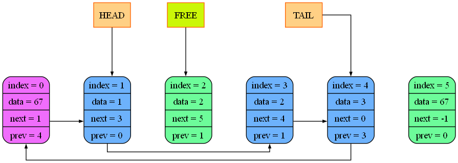

# **Doubly Linked List**

Реализация двусвязного списка на основе массивов на языке C

## Автор

Алексей Кушнир
МФТИ, ФРКТ 1 курс

## Описание проекта

В проекте реализован двусвязный список, который хранит элементы в трёх отдельных массивах:

- `data` — хранит значения элементов;
- `next` — хранит индексы следующих элементов;
- `pref` — хранит индексы предыдущих элементов.

Основные поля структуры:

| Переменная | Назначение |
|---|---|
| `data` | Массив значений |
| `next` | Массив указателей на следующие элементы |
| `pref` | Массив указателей на предыдущие элементы |
| `head` | Индекс начала списка |
| `tail` | Индекс конца списка |
| `free` | Индекс первой свободной ячейки |
| `capacity` | Вместимость списка |


## Основные возможности

- Инициализация списка.
- Вставка элемента по индексу (физический индекс, не логический!).
- Вставка элемента в начало списка.
- Вставка элемента в конец списка.
- Удаление элемента по индексу. (физический индекс, не логический!)
- Удаление первого элемента.
- Удаление последнего элемента.
- Проверка корректности структуры списка.
- Вывод содержимого списка в консоль.
- Создание графического дампа с помощью Graphviz.
- Создание HTML-отчёта с изображениями и информацией о состоянии списка.

Основные функции

## Набор функций

### Основные функции

| Функция | Аргументы | Назначение |
|---|---|---|
| `list_init()` | `double_linked_list_t* list, int capacity` | Инициализация списка и выделение памяти |
| `list_insert()` | `double_linked_list_t* list, int index, int element` | Вставка элемента по индексу |
| `list_insert_begin()` | `double_linked_list_t* list, int element` | Вставка элемента в начало списка |
| `list_insert_end()` | `double_linked_list_t* list, int element` | Вставка элемента в конец списка |
| `list_pop()` | `double_linked_list_t* list, int index` | Удаление элемента по индексу |
| `list_pop_begin()` | `double_linked_list_t* list` | Удаление первого элемента |
| `list_pop_end()` | `double_linked_list_t* list` | Удаление последнего элемента |
| `list_destroy()` | `double_linked_list_t* list` | Освобождение выделенной памяти |
| `print_list()` | `double_linked_list_t* list` | Вывод содержимого списка в консоль |

### Функции проверки и вывода

| Функция | Аргументы | Назначение |
|---|---|---|
| `list_verify()` | `double_linked_list_t* list` | Проверка корректности структуры списка |
| `list_dump_in_console` | `double_linked_list_t* double_linked_list_info` | Дамп списка в консоль | 
| `list_dump_html()` | `double_linked_list_t* double_linked_list_info`  | Создание HTML-отчёта с графическими дампами |

## Режимы работы
- В режиме DEBOG_MODE (если прописан #define DEBOG_MODE) работает верификатор, который выполняется при каждом действии со списком.
- В режиме GRAPHVIZ_MODE (если прописан #define GRAPHVIZ_MODE) создается папка, имеющая название соответсвующее текущему времени. 
  В эту папку добавляются картинки png для каждого действия со списком, а затем эти картинки вместе с буквенным дампом добавляются в html файл по порядку.

 В дампе отображаются:
- физические индексы ячеек;
- значения `next`. `pref`, `data` по соответсвующему индексу ячейки;
- связи `next`
- занятые и свободные ячейки (синим - занятые, зеленым - свободные);
- фиктивная нулевая ячейка (фиолетовым цветом).

## Пример графического дампа

Для кода ниже:

```
double_linked_list_t double_linked_list_info = DIL0;
list_init(&double_linked_list_info, 5);

list_insert(&double_linked_list_info, 0, 1);
list_insert(&double_linked_list_info, 1, 2);
list_insert(&double_linked_list_info, 2, 2);
list_insert(&double_linked_list_info, 3, 3);
list_pop(&double_linked_list_info, 2);

list_destroy(&double_linked_list_info);
```

Графический дамп находится в папке logs_images_<время>:



Полный дамп можно посмотреть открыв в браузере файл [GENERAL_DUMP](logs_images_11-06_18-10-22/general_dump.html)